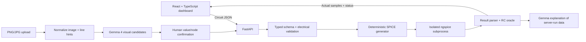

# CircuitLens

CircuitLens is an educational prototype for turning circuit schematics into editable circuit models, simulating them with ngspice, and explaining the results with Gemma 4. It is not certified electrical safety software or a professional EDA tool.

## Current milestone

- **Phase 2 complete:** typed circuit model, validation, deterministic SPICE generation, safe isolated ngspice execution, parsed `.tran` and `.op` results, and a tested seeded RC oracle.
- **Phase 3:** responsive dashboard with seeded RC, supported component-value editing, image upload/review, simulation plot and result states.
- **Phases 4–6:** local Gemma 4/Ollama adapter, visual component/value candidates, computer-vision wire-line hints, human confirmation flow and explanation grounded in a fresh ngspice run.
- **Live model validation is pending:** this checkout did not have Ollama or the Gemma model installed. The seeded simulator works independently; AI endpoints report Ollama unavailable until it is installed and the model is downloaded.

## Run locally (Windows PowerShell)

Use Python 3.10 or newer for a clean environment. Node.js 20 or newer is recommended.

```powershell
py -3.10 -m venv backend\.venv
backend\.venv\Scripts\Activate.ps1
python -m pip install -r backend\requirements.txt
Copy-Item .env.example .env
uvicorn app.main:app --app-dir backend --reload --host 127.0.0.1 --port 8000
```

In a second PowerShell window:

```powershell
cd frontend
npm install
npm run dev
```

Open the Vite URL (normally `http://localhost:5173`). The repository includes ngspice 36 for Windows under `tools/ngspice/bin`; the backend discovers it automatically. Set `NGSPICE_PATH` in `.env` to override the binary path. To run the backend tests:

```powershell
backend\.venv\Scripts\python.exe -m pytest backend\tests -q
```

To build the frontend:

```powershell
cd frontend
npm run build
```

## Architecture



Circuit values use SI units. Model output is untrusted and validated. Image detections are candidates until a user confirms them. Simulation runs use argument arrays, temporary working directories, subprocess timeouts, and explicit result parsing. Netlists are generated only from typed circuit data; arbitrary netlist text is not accepted.

## Environment variables

See `.env.example`. `NGSPICE_PATH` selects the simulator. The Gemma settings point to local Ollama. No API key is required for this local setup, and the model/image bytes stay on the local backend/Ollama path.

## Connect Gemma 4 with Ollama

Install Ollama for Windows, then run `ollama run gemma4:e2b` in PowerShell to download and start the image-capable E2B model. Copy `.env.example` to `.env` and keep `GEMMA_PROVIDER=ollama`, `GEMMA_MODEL_ID=gemma4:e2b`, and `GEMMA_BASE_URL=http://127.0.0.1:11434`. Restart the backend. `GET /api/health` exposes `gemma_available`; image upload uses `/api/analyze-image`, and the tutor uses `/api/explain`. The latter reruns ngspice on the server and does not trust client-supplied simulation numbers. Google documents the Ollama integration and image input at https://ai.google.dev/gemma/docs/integrations/ollama.

## Demo

1. Start the backend and frontend with the commands above.
2. The dashboard loads the 5 V, 1 kΩ, 10 μF seeded RC circuit and requests a real ngspice simulation.
3. Change the resistor value to 5000 Ω and run again. The computed time constant changes to 50 ms and the returned transient curve updates from ngspice samples.
4. Use the result card's analytical cross-check to compare simulator samples against `Vc(t)=Vs(1-exp(-t/(RC)))`.
5. Select a PNG/JPG, choose **Analyze with Gemma**, then review each candidate's value and terminal nodes. Explicitly confirm all connections before applying the circuit.
6. Ask the AI tutor a question after simulation; the backend reruns ngspice before constructing its evidence prompt.

## Known limitations

- Image recognition proposes visual candidates and line geometry. It does not make exact crossing/junction decisions; the user must correct and confirm terminal nodes.
- Live Gemma 4 inference requires the local Ollama runtime and configured model to be installed and available.
- The editor supports the initial component set; the automatic image reconstruction path is intentionally conservative and may require substantial manual topology correction.
- The plot uses actual parsed simulation vectors; no simulator data means no fabricated waveform.
- An ideal wire is collapsed into shared node topology during netlist generation rather than approximated with a resistor.

## Further planning

See [docs/implementation-plan.md](docs/implementation-plan.md) for milestone checklist, assumptions and current risks.
