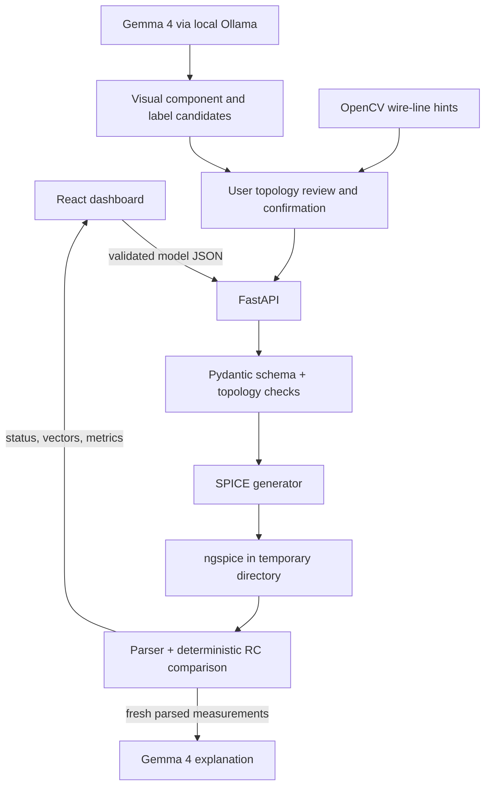

# CircuitLens implementation plan

## Progress checklist

- [x] Phase 0: inspect existing project, runtimes and simulator; review product/electronics/safety/acceptance context; verify official Gemma 4 image support and model IDs; document plan and architecture.
- [x] Phase 1: strict Pydantic circuit models, SI values, electrical validation and seeded RC fixture/tests (present before this continuation).
- [x] Phase 2: generate SPICE from typed circuits; invoke bundled/system ngspice safely with timeout and isolated temp directory; parse `.tran` and `.op`; compare RC samples against theory and test a resistor divider.
- [x] Phase 2 hardening: SPICE-safe names/units/finite values, ideal wire topology collapse, and reject empty/unparseable output as simulation success.
- [x] Phase 3: dashboard, upload and candidate review UI, model value/node correction, simulation outputs and AI tutor state.
- [x] Phase 4: local Ollama adapter for Gemma 4, configured by environment variables and validating structured output.
- [x] Phase 5: upload validation, image normalization, Gemma component/value/terminal candidates and OpenCV line/crossing hints; user confirmation is required.
- [x] Phase 6: explanation requires a valid confirmed circuit and successful fresh server-side ngspice results; response separates facts, theory, assumptions and hypotheses.
- [ ] Live Gemma acceptance test pending Ollama installation and Gemma model download on the user's machine.

## Architecture

## Assumptions and risks

- The included Windows ngspice 36 executable is the default on this checkout; another OS must install ngspice or set `NGSPICE_PATH`.
- Python and ngspice stdout may differ by version/platform. The runner requires parsed analysis data and returns an error if parsing yields nothing.
- Circuit labels and node identifiers are deliberately limited to safe SPICE tokens; display labels are not emitted as executable netlist syntax.
- The verified local provider is Ollama at `http://127.0.0.1:11434`, using model tag `gemma4:e2b`. The runtime and model are not installed in every development environment.
- Image interpretation proposes values and terminal candidates; it never confirms exact topology. The user explicitly reviews candidate values and all node assignments before simulation.
- OpenCV line and crossing detection is visual evidence only, not an electrical connectivity solver.

## Acceptance checks for Phase 2

- Seed RC netlist uses `V1 in 0 DC 5`, `R1 in out 1k`, `C1 out 0 10u IC=0`, `.tran ... UIC`, and `.end`.
- Actual simulator output has vectors and samples; a process return code by itself is insufficient.
- 1 kΩ × 10 μF gives 10 ms; 5 kΩ × 10 μF gives 50 ms.
- RC samples are compared against the closed-form response, with a documented 5% voltage-to-source tolerance.
- A 10 V, 1 kΩ/1 kΩ divider gives 5 V at its midpoint in operating-point analysis.
